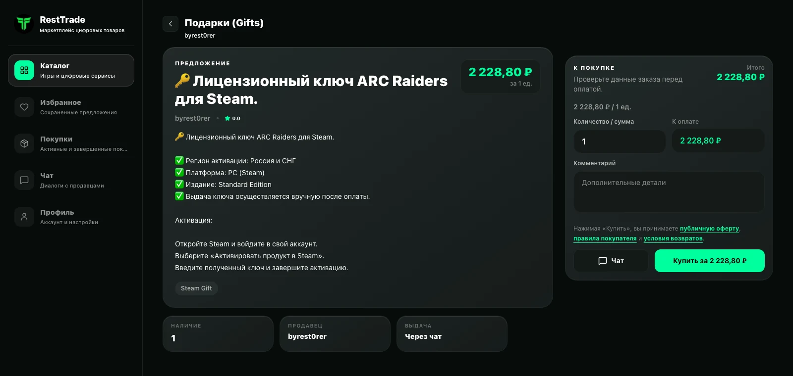
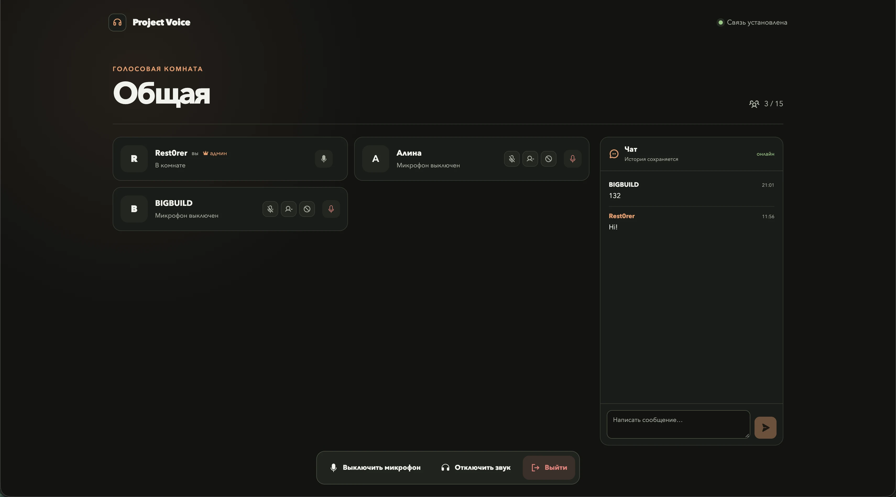

# Владислав Беляев

**Разработчик мобильных и веб-продуктов. Основной стек — Flutter/Dart.**

Разрабатываю и развиваю коммерческие приложения, веб-продукты и интеграции. Основной профиль — Flutter/Dart; также работаю с TypeScript, React, Next.js и Node.js, когда этого требует продукт. Использую AI-инструменты как ускоритель разработки, самостоятельно отвечая за архитектуру, проверку кода, тестирование и качество релизов.

[Портфолио](https://restworks.pro) · [GitHub](https://github.com/Rest00rer) · [Контакты](https://restworks.pro/ru/contacts)

## Избранные проекты

### Homio — платформа для рынка недвижимости
**K-Digital / коммерческий проект.** Работал над платформой для девелоперов и агентов: импортом документов с распознаванием данных с помощью AI-инструментов, AI-чатом и подборками, карточками проектов и юнитов, мастер-планами, локализацией, уведомлениями, PDF и медиа. Это главный пример моего недавнего опыта с TypeScript, React, Next.js, Node.js и PostgreSQL.

[Открыть кейс Homio](https://restworks.pro/ru/projects/kd_homio)

### Vezdevoz — транспортные и логистические приложения
**K-Digital / коммерческий проект.** Разрабатывал приложения для водителей и клиентов: рейсы, навигация, карты, отслеживание движения в реальном времени, передача координат через WebSocket, локальная очередь данных и уведомления о статусах.

[Кейс Vezdevoz Driver](https://restworks.pro/ru/projects/kd_vezdevoz_driver) · [Клиентское приложение](https://restworks.pro/ru/projects/kd_vezdevoz_app)

### Skorotut — сервис доставки
**K-Digital / коммерческий проект.** Развивал сервис заказа еды и товаров с каталогом, корзиной, оплатой, отслеживанием заказа, deep links, аналитикой и настраиваемыми уведомлениями. Также работал над кабинетом партнёров и курьеров с маршрутами, статусами, картами и мониторингом ошибок.

[Кейс Skorotut](https://restworks.pro/ru/projects/kd_skorotut_core) · [Кабинет партнёров](https://restworks.pro/ru/projects/kd_skorotut_partner)

### TCCG Mall и Parking — приложения торгового центра
**K-Digital / коммерческий проект.** Работал над приложением торгового центра с картой арендаторов, событиями и программой лояльности, а также над приложением для парковки с абонементами, оплатой через WebView, интеграцией с CRM и уведомлениями.

[Кейс TCCG Mall](https://restworks.pro/ru/projects/kd_tccg_app) · [Кейс TCCG Parking](https://restworks.pro/ru/projects/kd_tccg_parking)

### RestTrade — маркетплейс цифровых товаров
**Собственный продукт.** Спроектировал и собрал C2C-маркетплейс с каталогом, сделками, чатом, кабинетом продавца, двухстадийной оплатой, административной панелью и уведомлениями в Telegram.

[Открыть кейс RestTrade](https://restworks.pro/ru/projects/solo_resttrade)

### Project Voice — голосовая комната в реальном времени
**Собственный проект.** Самостоятельно создал сервис голосовых комнат, текстового чата, ролей участников, модерации и истории сообщений с WebRTC-аудио и развёртыванием через Docker.

[Открыть кейс Project Voice](https://restworks.pro/ru/projects/solo_project_voice)

## Другие проекты

В портфолио также собраны небольшие фриланс-проекты, экспериментальные работы и другие коммерческие проекты K-Digital. Они доступны на [сайте портфолио](https://restworks.pro), а здесь профиль сфокусирован на проектах, наиболее релевантных для продуктовой команды.

## Конфиденциальность

Исходный код коммерческих проектов, ключи доступа, данные клиентов и внутренние метрики не публикуются. Закрытые проекты представлены краткими описаниями и отдельными скриншотами. Более подробные технические детали могу показать или обсудить на собеседовании, если это допускается условиями проекта.
